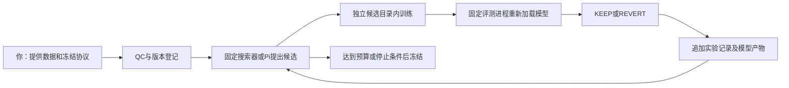

# Physio Autoresearch V0

这是分享对话中第一阶段的离线研究机器：加入一个明确的数据版本，自动做质检、受试者分组、有限次模型实验、独立评测、KEEP/REVERT 和记录。真实数据尚未整理，本轮交付使用合成样例。它不控制按摩椅，不替代 `representation/` 或 `massage_decision/` 的既有产品设计。

## 先运行

在仓库根目录的 PowerShell 中执行。当前 `.venv` 已安装需要的依赖。

```powershell
# 5 个合成受试者，12 个候选，完全离线，不调用模型 API
& .\.venv\Scripts\python.exe -m physio_autoresearch demo --subjects 5 --store runs/physio-v0

# 增加第 6 个合成受试者，自动创建新的数据版本和研究轮次
& .\.venv\Scripts\python.exe -m physio_autoresearch demo --subjects 6 --store runs/physio-v0

# 重现本次完整实验：5 人、6 人、相同版本续跑、1 人 fit-only、冠军推理
# 已追加的 AI 候选沿用原预算；续跑报告不会覆盖首次固定搜索快照。
& .\.venv\Scripts\python.exe -m scripts.physio_experiments
```

终端中的 `round` 是下一步 `status`、`run`、`predict`、Pi 命令使用的完整目录路径。相同数据和协议在同一个研究档案里重复执行，不重新开预算，也不重复训练已成功评测的配置。失败配置最多允许两次尝试；所有失败和拒绝都计入预算。



## 已实现的边界

| 部分 | V0 行为 |
|---|---|
| 数据 | 一个显式 CSV 路径、版本哈希和 provenance；原始快照不覆盖。公司数据只能位于仓库外或忽略的 `runs/`。 |
| QC | 严格列集合、唯一 record ID、有效 subject ID、数值与范围检查；拒绝无标签、无穷值和未来特征。重复 subject 的不同 session 合法。 |
| 缺失输入 | 保留 NaN；训练折内中位数填补，并始终输出每个字段的缺失标记，包括仅验证阶段才缺失的字段。 |
| 划分 | Leave-One-Subject-Out，同一个人的所有 session 保持在同一折。只有一个 subject 时只验证拟合，不计算验证分数、不晋升 Champion。 |
| 模型 | Naive mean、ElasticNet、Random Forest、XGBoost；小规模超参数和特征组搜索。 |
| 评测 | 单独进程加载每个折模型，校验数据、配置、split、模型哈希、预测完整性和有限值；重新计算指标。忽略模型日志中的分数。 |
| 指标 | 先按受试者平均绝对误差，再按合同里固定的 target scale 归一化，最后平均多个目标。另存每目标原始单位的 MAE。 |
| 晋升 | 当前代码版本先成功跑 Naive；仅低于上一 Champion 且达到固定阈值时 KEEP。失败或无改进只记录 REVERT，保留原 Champion。 |
| 预算 | 每个数据版本最多 20 次候选；训练、评测、失败及模型请求耗时累计；最多 20 次 Pi 模型请求，跨会话保留预留和 usage。 |
| 记录 | `experiments.jsonl` 追加记录，带本地哈希链；保存请求、fold 模型、预测、评测、错误和代码/环境 ZIP。 |
| 并发 | Python round 锁与 Pi 整会话 OS 锁；进程结束后由 OS 释放，不根据 lock 文件存在与否猜测进程状态。 |
| 推理 | 重新加载完整拟合的 Champion，仅接受 pre 输入，输出路径限定为该 round 的 `inference/`。 |

`constitution.synthetic.yaml` 的 `age/pre_hr/pre_hrv → post_hr` 和 target scale=10 只是演示合同。真实输入字段、单位、主要终点、BPSI/EFRI 定义、数据规模和最终验收阈值都需要你确定；不能把演示公式或采样数量当成公司或医学标准。实现支持多个真实 post outcomes，不预设 BPSI/EFRI 公式。

## 接入整理好的数据

先按真实字段复制和修改演示合同：`source: company`、字段单位、`phase: pre/post`、固定 target scales、协议版本和预算。合同应由你审核；Pi 工具没有修改合同或导入数据的权限。

```powershell
& .\.venv\Scripts\python.exe -m physio_autoresearch ingest 'E:\company-data\batch.csv' --contract configs/physio-company-v0.yaml --store runs/physio-v0 --run
```

这一个命令会完成 QC、版本登记和有限研究轮次。原始 CSV 的修改、新增独立受试者或人工批准的新协议会产生新版本。独立最终测试数据必须留在这个开发入口之外，不能每轮根据它决定 Champion。

核心代码或依赖变化时，旧 round 会拒绝继续执行。确认这次改动后，人工使用 `ingest ... --review-code-upgrade`：保存旧历史和预算、登记新源码/环境并重新要求基线。这个开关没有暴露给 Pi。预算已经耗尽时应等新数据或人工批准研究阶段变化；它不是重置预算的开关。不同 `--store` 是由人明确创建的独立研究档案，用于隔离试验；Agent 不能自行创建新档案来绕过预算。

宿主进程中断留下未完成的实验预留，或供应商请求没有结算记录时，会停止并要求检查，而不会自动猜测旧任务已经结束。普通训练崩溃和 timeout 会记录失败，后续允许范围内的实验继续。

## Pi 接入和上游复用

项目本地锁定 Pi SDK `@earendil-works/pi-coding-agent@1.0.2` 和 [pi-autoresearch@1.8.1](https://github.com/davebcn87/pi-autoresearch)。复用了上游纯 JSONL 状态恢复模块，供本地实验视图使用。专用 Pi SDK 会话仅注册 `research_status` 和 `research_candidate`，没有 bash/read/edit/write、任意路径、评测修改或 Git 操作工具。

上游通用 `run_experiment/log_experiment` 自动 commit/revert，因此本次没有把完整通用扩展加载进开发仓库。V0 使用独立候选目录和不可变配置快照隔离实验，不创建/回滚 Git 提交；固定训练实现接受模型参数和特征选择，不执行 Agent 提交的任意 Python 代码。

```powershell
# 只检查当前研究档案、上游状态重建和工具范围，不需要账户或模型调用
npm run research:pi -- --round '这里替换为实际round绝对路径' --check
```

在线运行另需明确选择供应商、模型和授权。启动器使用项目隔离的 `runs/physio-autoresearch/pi-agent/`，不会读取或搬运其他工具的凭据，也不会自动登录或切换模型。

```powershell
# 只有你确认账户及调用费用后才运行
npm run research:pi -- --round '实际round绝对路径' --provider '你的provider' --model '你的model-id' --allow-model-calls
```

在线工具反馈只包含候选配置、聚合指标、预算和失败代码，不发送原始数据、标签、预测、受试者 ID、个人级分数或本机路径。本轮验证了真实 Pi SDK、脚本化响应的工具循环以及真实 Python 子进程桥接，未调用真实供应商模型。Pi 选择下一轮实验的在线效果尚未验证。

另按你的授权使用 AGY 提出了一个合成实验候选。AGY 直接运行 CLI 被 Windows ACL 拒绝，当前工作区执行器执行原候选并由固定评测器判定 KEEP；这验证了外部 AI 提案与可信本地评测的交接，没有验证 Pi 供应商集成。详细执行事实见 `VERIFICATION.md`，没有改动文件权限。

## 测试和实验产物

```powershell
& .\.venv\Scripts\python.exe -m pytest tests/physio_autoresearch --basetemp runs/physio-tests -q
& .\.venv\Scripts\python.exe -m physio_autoresearch bench
npm run test:pi
```

安装可用 Python 3.12 创建本项目 `.venv` 后，使用 `requirements-autoresearch.lock.txt` 重现本轮环境，Node 使用 `npm ci --ignore-scripts`。如果本机全局 pip 配置损坏，可以仅在安装进程中设置 `$env:PIP_CONFIG_FILE = 'NUL'`。原来的深度学习和 Demo 依赖不属于这次 V0 环境。

所有原始数据快照、模型、实验 JSONL、推理 CSV、成本记录和测试输出保存在 Git 忽略的 `runs/`。首次固定搜索概要在 `runs/physio-v0/experiment-report.json`，续跑概要在 `experiment-replay-report.json`，追加 AI 实验审计在 `agy/host-verification.json`；稳定使用指南和验收概要在本目录。

## 证据限制和后续阶段

当前自动候选生成默认是可复现的固定搜索对照；Pi 可以在同一冻结规则下提候选，但实际在线运行尚未验证。V0 没有可执行代码自修改、Harness 候选晋升或无人值守每日任务。分享对话最终方案把这些放在后续阶段：先积累记忆与失败案例，再在固定成本和任务条件下比较旧、新 Harness，验证通过后才升级。不能把当前回归 Benchmark 通过说成已经证明 RSI。

进程分离、受限 Pi 工具和哈希校验是应用层边界。它们不是同一 Windows 用户之间的文件系统安全沙箱；拥有本机写权限的人仍可修改文件或重算哈希链。开放任意生成代码、保护真实 locked test 或运行未经审查的扩展之前，需要另建具备 OS 权限隔离的执行环境。

本轮模型全部是 `SMOKE_MODEL_NOT_VALIDATED`。低 MAE、成功训练和保留 Champion 都不能证明真实生理预测有效；后续需要冻结候选并用未参与搜索的新受试者独立确认。
